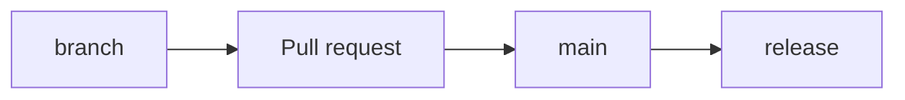

# Diagrams (Mermaid)

Lerret draws **[Mermaid](https://mermaid.js.org/)** diagrams — flowcharts,
sequence diagrams, ER diagrams, timelines and the rest. You write plain Mermaid
text; Lerret renders it as an artboard, gives it your brand's look, and exports
it like any other design.

## Why plain Mermaid

There is no Lerret dialect. A diagram file in your project is the same text
that renders on GitHub, in Notion and in most editors — so it stays readable
and portable outside Lerret. Everything Lerret adds (the brand look, images
from your project, page maps) comes from your folder and config, never from
special syntax in the file.

## Which one do I use?

| You want… | Write |
|---|---|
| A diagram as its own artboard (flow, sequence, ER, architecture, timeline…) | a [`.mmd` file](#mmd-files) |
| A diagram inside a designed visual (OG card, slide, social post) | a [`.jsx` asset that imports `mermaid`](#diagrams-inside-a-design) |
| A diagram inside notes | a [` ```mermaid ` fence](#diagrams-in-notes) in a `.md` file |
| A page's artboards arranged, with arrows between them | that folder's [`_index.mmd` page map](#page-maps-_indexmmd) |

## `.mmd` files

Any `.mmd` (or `.mermaid`) file inside `.lerret/` is an asset. Put it in a page
or group folder like a component:

```
.lerret/
└── product/
    └── signup-flow.mmd
```

```
flowchart LR
  visit([Visit site]) --> signup[Sign up]
  signup --> verify{Email verified?}
  verify -->|yes| onboard[Onboarding]
  verify -->|no| resend[Resend link]
  resend --> verify
  onboard --> done([First project])
```


- **Size.** The artboard is the diagram's own size plus 32 px of padding — no
  `meta`, nothing to set.
- **Create one in the studio.** *New asset → Mermaid diagram* writes a starter
  `.mmd` you can edit.
- **Errors.** Invalid Mermaid shows the asset's error card with Mermaid's own
  message (*Parse error on line 3…*). Other artboards keep rendering. An empty
  file shows an empty card.
- **Export.** Diagrams export to PNG and JPG like every artboard — from the
  studio or with [`@lerret/cli export`](/cli/#lerretcli-export). In the studio a
  diagram artboard also has an **SVG** download button.


### The look

Every diagram gets a clean finish: calm grey lines when there's no brand,
rounded boxes, quiet curved connectors with slim arrowheads, and edge labels
drawn as small chips so a line never runs through its text. You don't write
any of this — it comes with the file. (A frontmatter `themeCSS` in the file
replaces it if you really want your own.)

## Brand look

A diagram takes its colours, background and font from its folder's
[config](/concepts/#the-config-cascade) — there are no styling lines to add to
the file. Lerret looks in this order (later wins):

1. **The [brand library](/studio/#brand-library).** Its colours and text styles
   are mirrored into `config.json` as `brand-*` vars: the darkest colour becomes
   the text, the lightest the background, the most saturated the borders; the
   *Body* (or *Heading*) style sets the font.
2. **Vars with common names.** `paper` / `background` / `bg`, `ink` / `text` /
   `foreground` / `fg`, `accent` / `primary` / `brand`, `surface` / `card`,
   `line` / `border`, `muted`.
3. **A `mermaid.themeVariables` block** in any folder `config.json` (it
   cascades like everything else). A value starting with `$` points at a var:

   ```json
   {
     "vars": { "brandColor": "#B85B33", "neutralLight": "#F7F4F0", "neutralDark": "#1A1814" },
     "mermaid": {
       "themeVariables": {
         "background": "$neutralLight",
         "primaryColor": "$neutralLight",
         "primaryBorderColor": "$brandColor",
         "primaryTextColor": "$neutralDark",
         "lineColor": "$brandColor"
       }
     }
   }
   ```

4. **The file's own frontmatter.** It wins over everything — but Mermaid only
   applies frontmatter `themeVariables` when the frontmatter also sets
   `theme: base`:

   ```
   ---
   config:
     theme: base
     themeVariables:
       primaryBorderColor: "#00AA55"
   ---
   flowchart LR
     a --> b
   ```


Change a colour in `config.json` and every diagram in that folder re-renders
with it.

## Images in boxes

Mermaid's image node can show a file from your project. Write the path
**relative to the `.mmd` file** — Lerret embeds the image, so the canvas, PNG/JPG
exports and the SVG all include it:

```
flowchart LR
  logo@{ img: "../_brand/acme.png", label: "Acme", pos: "b", w: 60, h: 60, constraint: "on" }
  logo --> app[App]
```

Remote URLs are left as written. A missing file shows an empty frame, not an
error.

## Diagrams inside a design

When a diagram belongs **inside** a designed visual — an OG card, a slide, a
launch post — make a normal `.jsx` asset and import the plain `mermaid` npm
package:

```jsx
import mermaid from 'mermaid';
```

There is **nothing to install and no Lerret import**: Lerret provides `mermaid`
the same way it provides React. Your asset stays an ordinary React component
that works in any React app with `mermaid` installed.

The quickest start is the **Diagram card** template: *New asset* → pick a size →
template *Diagram card*. It writes a component like this, with the title and
chart text in the data file:

```jsx
import { useEffect, useId, useRef, useState } from 'react';
import mermaid from 'mermaid';

export default function ArchitectureCard({ title = 'How it works', chart = 'flowchart LR\n  a --> b' }) {
  const id = 'mmd' + useId().replace(/[^a-zA-Z0-9]/g, '');
  const box = useRef(null);
  const [svg, setSvg] = useState('');
  useEffect(() => {
    let live = true;
    const css = (name, fallback) => getComputedStyle(box.current).getPropertyValue(name).trim() || fallback;
    mermaid.initialize({
      startOnLoad: false, securityLevel: 'strict', htmlLabels: false, flowchart: { htmlLabels: false },
      theme: 'base',
      themeVariables: { primaryBorderColor: css('--brand-primary', '#5E6AD2'), primaryTextColor: css('--brand-ink', '#08090A') },
    });
    mermaid.render(id, chart).then((r) => { if (live) setSvg(r.svg); });
    return () => { live = false; };
  }, [id, chart]);
  return (
    <div style={{ width: '100%', height: '100%', padding: 64, boxSizing: 'border-box', background: 'var(--brand-paper, #FFFFFF)' }}>
      <h1 style={{ margin: 0 }}>{title}</h1>
      <div ref={box} data-lerret-pending={svg ? undefined : ''} dangerouslySetInnerHTML={{ __html: svg }} />
    </div>
  );
}
```


Three things to keep:

- **`data-lerret-pending`** on anything that draws asynchronously. Export waits
  until the attribute is gone (up to 10 seconds), so the image never captures a
  half-drawn diagram. Outside Lerret it does nothing.
- **`securityLevel: 'strict'` and `htmlLabels: false`.** Image export can't
  capture HTML labels reliably; SVG text labels always work.
- **Real colours, not `var(...)`.** Mermaid needs colour values, so read the
  brand CSS vars with `getComputedStyle` as above, with a fallback.

See it as a full example: [17. Architecture card](/examples/#17-architecture-card--diagram-card).

## Diagrams in notes

In a Markdown asset (`.md`), a ` ```mermaid ` code fence renders as a diagram
with the same look:

````md
## Release flow


````

## Page maps (`_index.mmd`)

Normally a page shows its artboards in one row. Add an **`_index.mmd`** to a
page or group folder and it becomes that folder's **layout**: every box named
after an asset in the folder is where that asset's real artboard sits, and
Mermaid's arrows and labels are drawn between them.

```
.lerret/social/_index.mmd
```

```
flowchart LR
  og-card -->|shared as| tw-banner
  og-card -.->|why| about-data-files
```


How it works:

- **Names.** A node id that equals an asset's name places that asset —
  `og-card` ↔ `og-card.jsx`, `about-data-files` ↔ `about-data-files.md`,
  `flow` ↔ `flow.mmd`. Names may use letters, digits, `_` and `-`; rename an
  asset with spaces to place it.
- **Everything else stays put.** Assets the map doesn't name, and extra
  [variants](/concepts/#variants-via-named-exports), keep the normal row below
  the map.
- **Flowcharts only.** `flowchart` / `graph`. Any other diagram type leaves the
  folder's normal layout alone.
- **Notes are `.md` assets.** For an annotation, add a Markdown asset and
  connect it like any card (`og-card -.-> notes`). Avoid free text boxes like
  `x[Some text]` — nothing anchors them, so they float wherever Mermaid puts
  them.
- **Live.** The page re-arranges when the map, an asset or the config changes,
  and uses the folder's brand look.
- **Spacing.** Tune it in the file's frontmatter (defaults: `nodeSpacing: 56`,
  `rankSpacing: 96`):

  ```
  ---
  config:
    flowchart:
      rankSpacing: 160
  ---
  flowchart LR
    og-card --> tw-banner
  ```

- **Hidden and not exported.** The map is the layout, not an artboard — it
  never appears as a card and `@lerret/cli export` skips it.
- **Groups have their own.** Each folder's `_index.mmd` arranges only that
  folder; a group with its own map is laid out inside its frame.

### Create and edit a map in the studio

*Page / group menu → **Create page map*** writes a starter `_index.mmd` with one
box per asset — then add arrows. Once a map exists the same item reads **Open
page map** (it opens the file in your code editor).


You can also edit the map right on the canvas. Every change rewrites the plain
`_index.mmd`:

| Do this | It writes |
|---|---|
| Hover a card → drag its round handle onto another card in the same folder | `og-card --> tw-banner` (the first arrow creates `_index.mmd`) |
| Click an arrow → type a label, press Enter | `og-card -->\|shared as\| tw-banner` |
| Click an arrow → **Dashed** / **Thick** / **Solid** | `-.->` / `==>` / `-->` |
| Click an arrow → **Delete** | removes that line |
| Map toolbar → **→ Left to right** | flips the map to `flowchart TB` and back |
| Map toolbar → **Edit file** | opens `_index.mmd` in your editor |


The canvas edits simple one-arrow lines (`a -->|label| b`). Chains like
`a --> b --> c` and `a & b --> c` still work, but edit those in the file.

## Limits

- No whole-page export of a map yet — export the artboards, or screenshot the
  page.
- No dragging cards to a position: Mermaid owns the layout, so positions would
  be lost on the next edit. Change arrows, direction or spacing instead.
- Sub-groups can't be placed as boxes in a map yet; they render below it.

## What's next

- **[Authoring Assets](/authoring/)** — components, data files, Markdown notes.
- **[The Studio](/studio/)** — creating assets, menus, export.
- **[Editing with AI Tools](/ai-editing/)** — the `/lerret` skill knows all of
  the above, so you can ask for a diagram in plain words.
